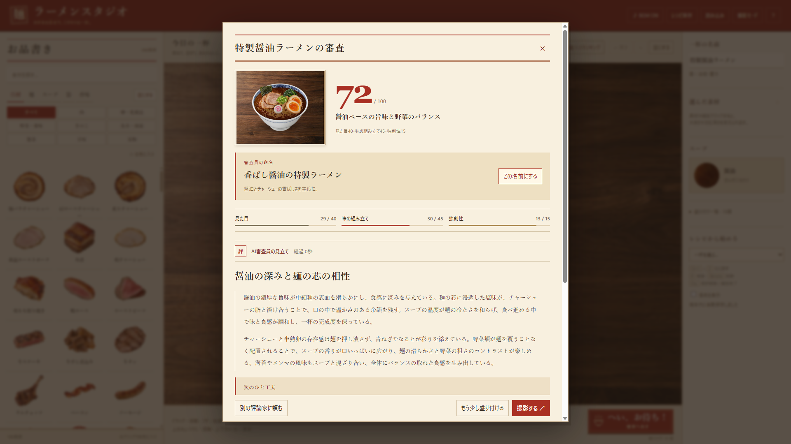
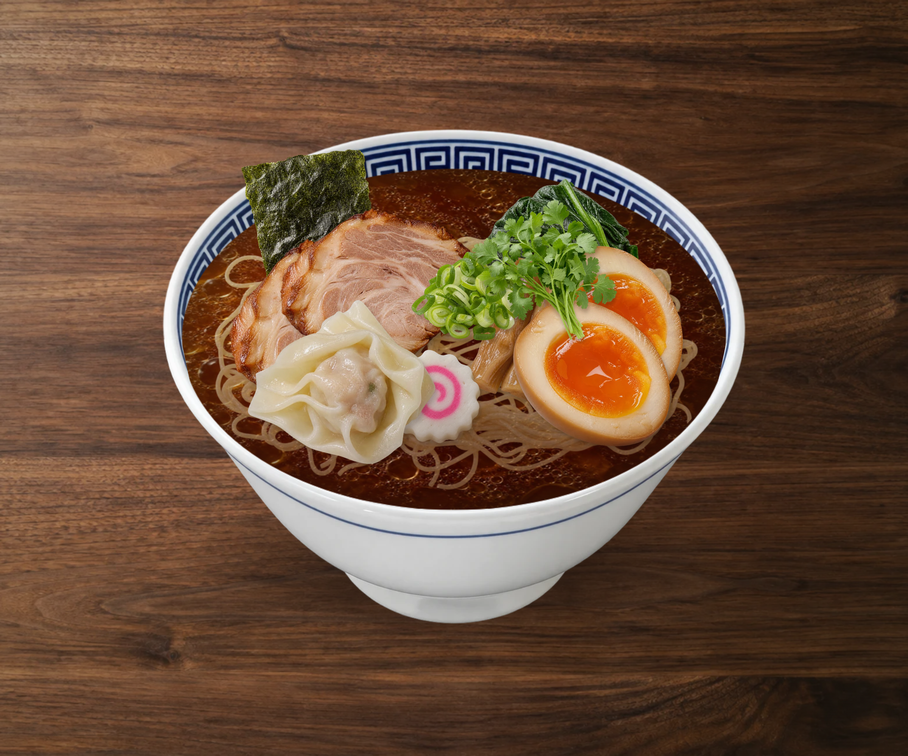

# ラーメンスタジオ 🍜

写真風の食材を自由に盛り付けて、ローカルAIの審査員に採点・評論してもらうWindowsゲームです。
具材186種類、スープ24種類、麺20種類、器24種類、香味油・調味料12種類。王道の一杯も、とんでもない創作も作れます。

**[配布版 v0.4.54 をダウンロード](https://github.com/mezon-web/RamenM-Releases/releases/tag/v0.4.54)**



## ダウンロード

**[Windows用7z・v0.4.54（約145.2MB）](https://github.com/mezon-web/RamenM-Releases/releases/download/v0.4.54/RamenStudio-v0.4.54-win-x64.7z)** をダウンロードしてください。AIモデルは未取得の場合だけ、アプリ内から約4.59GBを一度取得します。

### 起動する

1. 7zファイルを [7-Zip](https://7-zip.org/) などで、フォルダごと展開します。
2. `ラーメンスタジオ-v0.4.54` フォルダ内の **ラーメンスタジオ.exe** を起動します。
3. AIモデルが未取得なら、上部の **AIの準備** からダウンロードします。取得中も盛り付けできます。
4. 食材を盛り付けて **へい、お待ち！** を押すと、審査が始まります。

展開したフォルダのいちばん上には、起動用の **ラーメンスタジオ.exe**、**はじめに.txt**、**runtime** の3つがあります。起動は最上位のラーメンスタジオ.exe。runtimeは動作に必要なファイルなので、そのまま保持してください。移動するときはフォルダ全体を一緒に移動してください。

準備画面には実際の保存先フォルダを表示します。

一度取得したモデルは、次回起動やアプリ更新後も使えます。中断したダウンロードは続きから再開できます。
同じGemmaモデルが取得済みなら、モデルなし版でも再ダウンロードしません。v0.4.50ではGemma 4 E4Bへ切り替えたため、旧Qwenモデルだけがある場合は新モデルを初回に取得します。旧モデルは削除しません。
モデルの取得にはWindowsのプロキシ設定（手動設定・自動構成スクリプトなど）を使用します。

GitHubの「Source code (zip / tar.gz)」は、このページの説明書と画像です。ゲーム本体は上記の配布ファイルを取得してください。

## 遊び方

- 具材の **すべて** は、肉・卵／乳製品・野菜／薬味・きのこ・魚介／海藻・惣菜・甘味・果物の順にまとまっています。後から追加した具材も、それぞれの種類の中にあります。
- お品書きから器・スープ・麺・具材を選びます。スープと麺は一種類ずつ、具材は好きなだけ追加できます。
- 具材をドラッグで移動。選択枠の端で大きさ、上のツマミで角度を調整できます。反転・削除・手前・奥・沈める・浮かすのボタンも使えます。
- お品書き右端や盛り付け画面の **空にする** で、麺・具材・香味をまとめて外せます。器とスープは残り、取り消しで元に戻せます。
- **♪ BGM ON / ♪ BGM OFF** でBGMの状態を確認・切り替えできます。設定は次回起動時にも引き継ぎます。
- 左の **具材・香味** は、器へドラッグして好きな位置に新しく配置できます。器外で離すか **Esc** で取り消します。クリックによる追加も使えます。
- 盛り付けた素材の **右クリック** で、複製・反転・重なり順・浮沈・お気に入り・削除のメニューを開きます。矢印キーで選んで **Enter** でも操作できます。
- 選択した素材の近くの **複製**、右パネル、**Dキー** で同じ素材を追加できます。左のカードの右クリックはお気に入り登録です。
- **へい、お待ち！** で審査へ。審査が終わったら、点数・評論・改善案の詳細を自動で開きます。同じ盛り付けの結果が保存済みなら、詳細を直接開きます。
- 審査中のひとことは上段の **評** の横に表示し、8秒ごとに変わります。準備や書き直し中は、その案内を表示します。
- **審査員の手帳** には、土台・具の組み合わせ・量の評価がまとまるたびに根拠文が追記されます。下まで読んでいるときは新しい書き込みへ自動で移動します。
- 名前欄は、殿堂入りボタンと同じ上の帯の中央にあります。詳細画面でも編集でき、右上の **登録する** で名前を保存し、殿堂入りの対象にします。閉じるだけでは登録されません。殿堂入りには初回の審査を記録します。
- 点数の下には、スープ・麺・主役と味や食感が伝わる一杯の紹介文を表示します。
- **総合点** は、麺・スープ・香味の土台、具の働き、具体的な欠点を理由付きで評価した100点満点の点数です。詳細では **評価点・欠点と採点の根拠** を確認できます。
- 審査ごとに、コク・香り・食感・発想など好みの違う評論家が担当します。詳細画面で担当の好みを確認できます。**別の評論家に頼む** では、直前と異なる観点で評論と点数を再評価します。
- 性能設定は **自動（専用GPU優先）**。利用可能な専用GPU、内蔵GPU、CPUの順で使用し、速度測定は行いません。CPUの生成用・入力用スレッド数は論理プロセッサ数の2/3（端数切り捨て、最低1）です。
- 右上の歯車からCPU／GPU・スレッド数・優先度を手動指定できます。審査後にAIをメモリへ残す時間も選べます。
- **次のひと工夫** の下に表示される **審査員の命名** を読んで、気に入った名前は **この名前にする** で入力欄へ入れ、**登録する** で保存できます。
- 写真をPNGで保存したり、レシピファイルを保存・読み込みしたりできます。新基準で高評価になった一杯は殿堂入りランキングから見られます。
- ランキングでは、審査当時の写真と詳細評価も開けます。

評論は2段落で、今回の加減点の根拠となった味・香り・食感の理由を読み進められます。

AIが点数、食材の相性、評論、改善案、称号、ヘルシー度の目安と概算カロリーを考えます。食材情報と盛り付けの見え方をもとにしたゲーム上の審査です。



## 必要な環境

- Windows 10 / 11、64bit（x64）。専用GPUは不要です。
- メモリ16GB以上を推奨します。審査時間はPCの性能や空きメモリによって変わります。
- 初回にAIモデルを取得する場合はインターネット接続が必要です。準備後のプレイ・AI審査・保存はオフラインで動きます。

AIソフトの別途インストール、アカウント、APIキーは不要です。審査のために一杯の情報や画像を外部サービスへ送信しません。
実行ファイルだけを取り出さず、展開したフォルダ全体を保持してください。

## 今回の採点

麺・スープ・香味の土台が最大60点、具の働きが4項目で最大40点。具と土台の味、麺と具の食感、香りと後味、具同士のまとまりを評価し、具体的な害を減点します。数や珍しさだけでは加点しません。

具なしは具の加点がなく、実質60点まで。香味油は土台の味付けとして扱います。麺なしは土台0点で、今ある具の働きは評価します。空の器は0点です。意味のある組み合わせを探して、一杯を育ててみてください。

今回の基準で殿堂入りを新しく記録します。保存レシピ・手動の性能設定・モデル保持時間は引き続き利用できます。旧ランキングと旧モデルのファイルは残ります。

## 更新と保存

起動中のアプリを閉じてから、新しい版を別フォルダへ展開して起動してください。
自動保存・殿堂入り・審査結果はPC内に保存され、モデルは `%LOCALAPPDATA%\RamenStudio\models` の共通保存先を再利用します。別PCへ作品を持ち運ぶには、ゲーム内で保存したレシピファイルを使ってください。

配布ファイルのSHA-256は、Releaseの [SHA256SUMS.txt](https://github.com/mezon-web/RamenM-Releases/releases/download/v0.4.54/SHA256SUMS.txt) で確認できます。

```powershell
Get-FileHash -Algorithm SHA256 -LiteralPath '.\RamenStudio-v0.4.54-win-x64.7z'
```

このリポジトリは配布版と利用者向け文書を管理します。開発ソースのリポジトリは非公開です。
[変更履歴](CHANGELOG.md) / [第三者ソフトウェアの表記](THIRD-PARTY-NOTICES.md)
